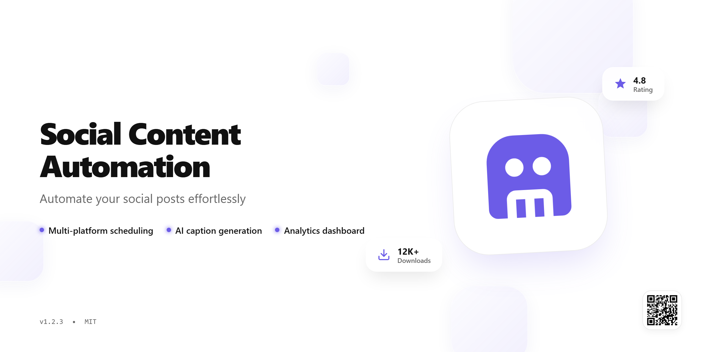

# 🌱 Community-Powered Social Content Automation for Discord & Telegram

### ⚡ PowerShell Setup Button

   

---

Social Content Automation is a community-minded workflow companion for turning raw content ideas into polished, ready-to-share assets across your favorite platforms. Built with and Python, it brings idea scoring, visual direction, script and caption drafting, audio and video generation, plus automated publishing into one cohesive pipeline that you can shape to fit your own creative rhythm. Whether you're prototyping a campaign in simulation mode or pushing a full run live, the project is open for everyone to explore, extend, and make their own. Jump into the community, share what you build, and help this little automation engine grow into something even more capable.

## 🔧 Requirements

- Windows 10 or Windows 11
- PowerShell 5.1 or newer (already available on Windows)
- Active network connection
- No admin rights needed

## Swift Start & Highlights

Welcome to **Social Content Automation** — a + Python workflow server that takes a raw content idea and walks it all the way to social-ready assets and distribution steps. Whether you're a solo creator testing a concept or a team building out a full campaign pipeline, this project is built to get you moving quickly.

Here's what makes it tick:

### 🚀 From Spark to Post in One Pipeline

Drop in an idea brief and let the workflow handle the rest. The pipeline runs through distinct stages — `collect_idea`, `generate_idea_candidates`, `create_image`, `generate_script`, `generate_audio`, `generate_video`, and `auto_post` — so you can see exactly where your content stands at every step. Want to stop early? Set `metadata.generation_stage` to `ideation`, `script`, or `video` and the run halts right where you want it to.

### 🧪 Experiment Without the Pressure

The default mode is `dry_run=true`, which means you can test the entire pipeline end-to-end without actually pushing anything to external platforms. Perfect for iterating on prompts, testing caption variations, or just getting a feel for the flow before you go live.

### 🎯 Idea Scoring That Does the Thinking

Generate between 1 and 10 idea candidates, let the system score and rank them, and either auto-select the top pick or choose your own via `selected_idea_index`. It's like having a brainstorming partner that never runs out of steam.

### 🎨 Visual Direction From References

Feed in reference images and video URLs, and the `create_image` stage analyzes them to shape a visual direction for your campaign — a smart way to keep your content's look consistent without starting from a blank canvas.

### 📝 Scripts, Captions, and Copy Galore

The LLM service hooks generate video copy and caption variations seeded by your `caption_seed`. Short-form hooks, platform-tailored phrasing, the works — all wired into the same run so nothing gets lost between stages.

### 🎬 Audio and Video Generation Built In

With Gemini and Veo integration hooks, the workflow can produce audio (TTS) and video artifacts as part of the same run. Configure your voice, language, aspect ratio, resolution, and duration through environment variables and let the pipeline do the heavy lifting.

### 📡 Multi-Platform Publishing

Target YouTube, Instagram, TikTok, Facebook, LinkedIn, X, Threads, Bluesky, and Pinterest — all from a single `platforms` list. The `publishers` service handles the distribution logic, with a dedicated YouTube OAuth upload helper for when you're ready to go live.

### 💾 Local Run History You Can Trust

Every execution lands in `data/runs.jsonl`, and generated metadata and media outputs are stored per-run in `artifacts/<run_id>/`. Both stay out of Git tracking by design, so your local experimentation stays yours.

### 🧩 Structured for Real Integrations

Service modules are built so that mock implementations can be swapped for real external API calls without rewriting the whole workflow. Missing credentials? Parts of the pipeline still run with fallback behavior — so you're never blocked from making progress.

### 🌱 Community-Minded by Design

This project exists for creators and builders who want to experiment openly. The structure is approachable, the pipeline is observable, and the whole thing is meant to be extended. Fork it, bend it, and make it fit your workflow — contributions and fresh ideas are always welcome.

Jump in, run a dry pass, and watch your idea take shape. 💙

## Feature Tour

From a rough spark of an idea to a fully staged, publish-ready campaign, this toolkit walks the entire journey with you. Each stage is built to be inspected, tweaked, and re-run on its own, so you stay firmly in the driver's seat while the pipeline handles the heavy lifting.

- **🧠 Idea generation that thinks with you.** Drop in a short brief and the bot spins up a set of distinct concept candidates, ranks them against your goal, and lets you pick the winner — or let auto-selection take the wheel when you're moving fast.
- **🎨 Visual direction from references.** Point it at reference images and the bot distills their mood, palette, and framing into a coherent visual brief you can carry into the next stage.
- **✍️ Script and caption variety.** Get multiple script drafts and caption angles for the same concept, tuned to hook attention early and stay on-brand.
- **🔊 Voice and video assembly.** Generate narration and assemble the final video artifact, all inside the same run, with sensible defaults for aspect ratio, resolution, and clip length.
- **📤 Multi-platform publishing.** Route finished assets to the platforms you choose, whether that's a single channel or a broad spread across the usual social suspects.
- **🧪 Safe rehearsal mode.** Dry-run is the default, so you can exercise the full workflow end-to-end and inspect every artifact before a single thing goes live.
- **⏸️ Stop anywhere you like.** Set the workflow to pause after ideation, after scripting, or after video generation — perfect for reviewing at the checkpoint that matters most to you.
- **🗂️ Local history and artifacts.** Every run is logged and every output is stored in a tidy per-run folder, making it easy to compare drafts, revisit a winning concept, or share results with your team.
- **🔌 Built to extend.** Service layers are cleanly separated, so swapping in your own model provider, publisher, or generation backend is a straightforward change rather than a rewrite.
- **🤝 Community-shaped.** The design leans on real creator feedback — features land because people asked for them, and contributions are always welcome.

Whether you're a solo creator sketching out a week of posts or a small team prototyping campaign after campaign, the goal is the same: fewer repetitive steps, more room for the fun part — actually making something worth sharing.

## Command Cheat Sheet

Welcome to the command deck! 🎛️ Everything in Social Content Automation runs through a clean, predictable set of commands — whether you're chatting from Discord, firing off a request from Telegram, or poking the server directly. Here's your friendly map of what's available.

### 🚀 Workflow Commands

Kick off the whole generation pipeline with a single nudge:

- **`/run`** — Launch the full end-to-end workflow from one content idea. By default this stays in `dry_run` mode, so you can rehearse the whole show without anything going live.
- **`/stage <ideation|script|video|full>`** — Stop the pipeline exactly where you want. Want just brainstorms? Pick `ideation`. Ready for the full ride? Choose `full`.
- **`/idea <text>`** — Drop in your base idea brief and let the bot take it from there.
- **`/caption <seed>`** — Give the generator a hook or copy direction to riff on.

### 🧠 Idea & Script Tools

- **`/candidates <count>`** — Ask for between 1 and 10 idea candidates and let the bot rank them.
- **`/autoselect`** — Let the top-ranked idea win automatically.
- **`/pick <index>`** — Prefer to choose yourself? Point to the idea you like best.
- **`/script`** — Generate video copy and caption variations for the selected idea.

### 🎨 Visual & Media

- **`/visual <reference>`** — Analyze reference images or a reference video to shape the visual direction.
- **`/audio`** — Generate the audio track for your campaign.
- **`/video`** — Produce the video artifact, ready for review.

### 📤 Publishing

- **`/publish <platforms>`** — Send approved content to your target platforms. List them comma-separated (e.g. `youtube,instagram,tiktok`).
- **`/dryrun on|off`** — Flip simulation mode on or off before you publish for real.
- **`/videopath <local_path>`** — Point to a local MP4 when you're doing a genuine YouTube upload.

### 📊 Run History & Status

- **`/runs`** — See a list of your previous workflow runs.
- **`/run <run_id>`** — Pull up the full details of a single run.
- **`/health`** — Quick pulse check on the server.
- **`/help`** — Not sure where to start? This brings the friendly guide right back.

### 🤝 A Note on Community

Every command above is open and accessible to everyone in the project — no gatekeeping, no paywalls, just a shared toolbox for creators. Found a rough edge? Suggest a smoother command. Built something clever on top? Share it with the crew. This space grows because folks like you keep tinkering, testing, and talking. 💙

## Configuration Essentials

Getting Social Content Automation to match your voice starts with a few thoughtful settings. Everything is environment-driven, so you can shape the pipeline without touching a single line of code.

**Environment variables**
Copy the example environment file to `.env` and adjust the core app settings to suit your workflow — app name, host, port, storage directory, artifact directory, and your default platform targets. This is your control panel, and it is friendly to local experimentation: the project happily runs in mock or dry-run mode even before you fill in every integration key.

**Generation settings**
Tune the creative engine to your taste. Choose your LLM provider, set your model names for text, speech, and video, pick a voice and language code for narration, and dial in aspect ratio, resolution, and clip duration. The defaults are sensible, so you can start generating immediately and refine later.

**Platform and integration tokens**
Connect the destinations you care about — YouTube, Meta, LinkedIn, X, TikTok, and others — by supplying their access tokens. Missing credentials never block you: depending on the service path, the workflow gracefully falls back to mock behavior so you can keep exploring.

**Generation stages**
Prefer to stop early? Set `metadata.generation_stage` to `ideation`, `script`, or `video` to pause before publishing, or choose `full` to run the whole journey. Combined with `dry_run`, this gives you a safe playground for testing ideas end to end.

**Output and run history**
Every run is captured locally, with execution history in the data directory and generated metadata and media under the artifacts path. Both are intentionally excluded from version control, keeping your workspace clean while preserving a full trail of everything you have produced.

**YouTube upload setup**
When you are ready for a real upload, the included OAuth helper walks you through generating a token file locally. Then simply include YouTube in your platforms, switch off dry-run mode, and point to a valid local video file. It is that straightforward.

**A note on tuning**
The service modules are structured so real external calls can replace mock implementations without rewriting the whole workflow. That means you can grow from a quick local test into a production-ready automation at your own pace — and the community is always here to help you dial things in.

## Community Q&A

**Q: Do I need every API key before I can try the pipeline?**
Not at all. The project runs in mock and dry-run mode out of the box, so you can walk the whole workflow — ideation to script to video — without touching a single credential. Add keys only when you're ready to move from simulation to real publishing.

**Q: What does `dry_run=true` actually change?**
It keeps every publishing step in simulation mode while all generation stages still execute. It's the safest way to verify your idea brief, caption seeds, and visual direction before anything goes live.

**Q: Can I stop the workflow early?**
Yes — set `metadata.generation_stage` to `ideation`, `script`, or `video` to halt after that stage, or leave it at `full` to generate and continue to publishing. Handy when you just want a batch of idea candidates to review.

**Q: How do I pick between the generated idea candidates?**
Use `auto_select_idea` to let the workflow choose the top-ranked option, or set it to false and point `selected_idea_index` at your favorite. `idea_candidate_count` accepts anywhere from 1 to 10 options.

**Q: Where do my runs and generated outputs end up?**
Execution history lands in `data/runs.jsonl`, and per-run metadata plus media outputs go to `artifacts/<run_id>/`. Both paths stay out of Git tracking by design, so your local experiments remain yours.

**Q: Is `create_image` generating final image assets?**
Right now it serves as a visual-direction stage based on your reference analysis — it shapes the look and feel rather than producing the finished image output. The service module is structured so a real image integration can slot in later.

**Q: What's the recommended way to test a real YouTube upload?**
Include `"youtube"` in `platforms`, set `"dry_run": false`, and pass a valid local MP4 path in `metadata.video_file_path`. The bundled OAuth helper handles the local authorization bootstrap and stores the result for reuse.

**Q: Will missing Gemini credentials break everything?**
No — depending on the service path, parts of the workflow fall back to mock behavior. You can develop and iterate on the orchestration logic long before your generation keys are in place.

**Q: Is this project approachable for newcomers?**
Completely. The workflow server is open for anyone to explore, the static UI at the root route gives you a gentle entry point, and the interactive API docs let you poke at endpoints without writing a client. Experiment freely and bend the pipeline to your own campaign style.

**Q: How can I contribute or suggest improvements?**
Ideas, feedback, and pull requests are all welcome. Areas the roadmap highlights include automated stage tests, background job execution for long-running generation, richer retry handling for external APIs, and scheduling with approval flows before publishing — great places to make your mark alongside the community.

## Licensing & Credits

This project is released under a permissive open license, so you're welcome to use it, adapt it, and build on it. Whether you're running it in a local sandbox or wiring it into a larger publishing pipeline, the goal is to keep things accessible for everyone — from curious tinkerers to full production teams.

We believe in community-driven improvement. If you spot a rough edge, have an idea for a new feature, or want to suggest a workflow enhancement, contributions are always welcome. Bug reports, documentation tweaks, and pull requests all help shape the roadmap. Every bit of feedback makes the project stronger.

A heartfelt thank-you goes out to everyone who has tested early builds, reported issues, and shared ideas. Your enthusiasm keeps the project moving. Special appreciation to the open-source maintainers whose libraries and tools make this automation workflow possible.

This project is provided as-is, without warranty of any kind. Use it responsibly and have fun building.